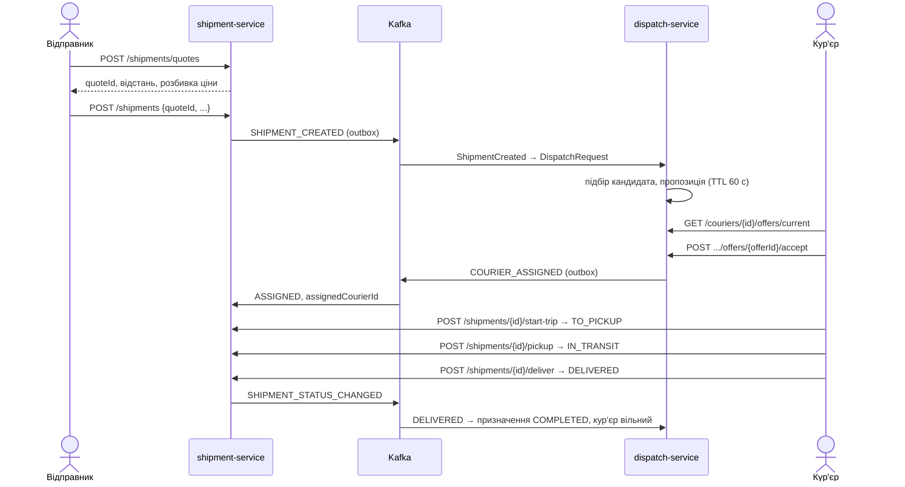

# Бізнес-логіка Shipment і Dispatch

Реалізація сценаріїв з `ARCHITECTURE_PROPOSAL.md` (dz_2):
1. створення доставки та призначення кур'єра;
2. виконання доставки;
3. скасування.

Додатково з Business_cases: **US-1.5** (мої доставки й таймлайн), **US-1.6 / US-2.4** (редагування з перерахунком ціни), **US-2.3 / US-2.5** (тип доставки й розбивка ціни), **US-3.5** (режим «на лінії»).

Pricing — окремий пакет `com.delivery.shipment.pricing` усередині `shipment-service`. Із рештою коду він спілкується лише через `PricingService`, тож його можна винести в окремий сервіс без змін у Shipment.

## 1. Наскрізний флоу



## 2. Pricing і Maps/Routing API

**Тариф:** `basePrice + distanceKm × pricePerKm + weightKg × pricePerKg`, далі множник типу доставки. Габарити на ціну не впливають (рішення команди в dz_2). Значення задаються у `pricing.*` в `application.properties`.

| Параметр | За замовчуванням |
|---|---|
| `pricing.base-price` | 50.00 |
| `pricing.price-per-km` | 1.50 |
| `pricing.price-per-kg` | 10.00 |
| `pricing.express-multiplier` | 1.5 |
| `pricing.quote-ttl` | 15m |

**Пропозиція ціни (PriceQuote).** `POST /shipments/quotes` геокодує адреси, рахує відстань і ціну та зберігає пропозицію з терміном дії. Розбивка повертається як: базова ставка → надбавка за відстань → надбавка за вагу → множник типу → підсумок. Під час створення доставки маршрут, вага, тип, відстань і ціна беруться **з пропозиції**, тож клієнт не може підмінити погоджену ціну.

Обмеження пропозиції:
- одноразова: рядок блокується в транзакції створення, тож одночасні запити не використають її двічі;
- прострочена → `422 quote-expired`;
- уже використана → `409 quote-already-used`;
- чужа поводиться як неіснуюча → `422 quote-not-found`.

**Maps/Routing API — ACL з офлайн-реалізацією.** Доменний код працює лише з інтерфейсом `RoutingClient`. Реалізація `OfflineRoutingClient` не робить мережевих викликів:
- **Що на вході.** Населений пункт задається KATOTTG-кодом, який UI вже передає з автодоповнення (`pickupCityCode` / `deliveryCityCode`).
- **Координати населеного пункту.** Перші дві цифри коду визначають область; береться центр області й детерміноване зміщення за кодом пункту.
- **Координати адреси.** До них додається невелике зміщення за хешем вулиці.
- **Відстань.** Haversine × 1.3 (коефіцієнт звивистості доріг), мінімум 1 км.
- **Невідомий код або порожня вулиця** → `422 address-not-geocodable`, доставка не створюється (US-1.1).

Однакові адреси завжди дають однакові координати й ціну. Реальний провайдер (наприклад, OSRM) підключається новою реалізацією `RoutingClient`.

## 3. Shipment: машина станів

```
WAITING_FOR_COURIER ──CourierAssigned──▶ ASSIGNED ──start-trip──▶ TO_PICKUP ──pickup──▶ IN_TRANSIT ──deliver──▶ DELIVERED
        ▲                                   │                        │
        └──────── CourierUnassigned ────────┴────────────────────────┘   (відмова кур'єра до забору посилки)

WAITING_FOR_COURIER / ASSIGNED / TO_PICKUP ──cancel (відправник)──▶ CANCELLED
```

| Правило | Поведінка |
|---|---|
| Початковий статус | Завжди `WAITING_FOR_COURIER`; статус, ціну й відстань задає система |
| `pickup` з `ASSIGNED` | Дозволено (крок «почати рух» необов'язковий), `tripStartedAt` заповнюється автоматично |
| Скасування до забору | Дозволено; якщо кур'єра вже призначено, `courierId` потрапляє в подію, і Dispatch звільняє кур'єра |
| Скасування після забору | `409`: «кур'єр уже забрав посилку» |
| Дії кур'єра | Лише призначений кур'єр (`403` для інших); недозволений перехід → `409` |
| Повтор команди | Повтор того самого переходу нічого не змінює (ідемпотентно) |
| Редагування | Лише відправник і лише в `WAITING_FOR_COURIER`; зміна маршруту, ваги чи типу перераховує ціну й відстань |
| `CourierAssigned` для скасованої доставки | Ігнорується; Dispatch звільнить кур'єра, коли отримає `CANCELLED` |
| `CourierUnassigned` після забору | Ігнорується: Shipment — джерело істини щодо того, хто везе посилку |
| Паралельні зміни | `@Version` (оптимістичне блокування): `409 concurrent-update` для HTTP і повтор для Kafka |

Кожен перехід в одній транзакції:
- оновлює агрегат;
- пише запис у таймлайн (`shipment_status_history`: звідки → куди, хто, коли, причина);
- пише `SHIPMENT_STATUS_CHANGED` в outbox.

## 4. Dispatch: пошук і призначення кур'єра

**Snapshot.** `DispatchRequest` зберігає з `SHIPMENT_CREATED` / `SHIPMENT_DETAILS_UPDATED` координати, вагу, адреси, ціну й тип. Тож повторний пошук не звертається до Shipment.

**Кандидат** має відповідати всім умовам:
- на лінії (`isAvailable`);
- `maxPackageWeight` не менша за вагу посилки;
- немає іншої активної пропозиції (не більше однієї на кур'єра; гарантується блокуванням рядка кур'єра);
- активних доставок менше за `dispatch.max-active-assignments` (3);
- зона обслуговування збігається з точкою забору: область за KATOTTG, м. Київ і Київська область — одна зона;
- кур'єр не відхиляв, не проґавив і не покидав цю доставку раніше.

**Ранжування:** менша відстань до точки забору → менше активних доставок → довше без замовлень. Відстань рахується від останньої відомої геопозиції, якщо вона свіжа (≤ 15 хв). Інакше — від центру зони кур'єра.

**Пропозиція (US-3.2)** діє `dispatch.offer-ttl` (60 с). Прийняття створює `Assignment` і публікує `COURIER_ASSIGNED`. Відхилення або тайм-аут (планувальник щоп'ять секунд) передає доставку наступному кандидату.

**Немає кандидатів:** доставка лишається в `WAITING_FOR_COURIERS`. Якщо кур'єра немає довше за `dispatch.search-delay-threshold` (2 хв), один раз публікується `COURIER_SEARCH_DELAYED` для сповіщення відправника (US-3.1). Пошук повторюється:
- кожні 30 с;
- одразу, коли кур'єр виходить на лінію, звільняється, відхиляє пропозицію або змінює профіль.

`EXPRESS` у черзі обслуговується першим (US-2.3).

**Відмова від призначення (US-1.7, US-3.4):**
- **До забору посилки.** Призначення переходить у `COURIER_WITHDREW`, публікується `COURIER_UNASSIGNED`. Shipment повертає доставку в `WAITING_FOR_COURIER`, а пошук стартує заново без цього кур'єра.
- **Після забору.** `409`.
- **Гонитва.** Dispatch дізнається про забір посилки з події (затримка outbox — до 1 с). Якщо відмова надійшла в цьому вікні, вона приймається, але подія `IN_TRANSIT` з тим самим `courierId` повертає призначення, а пропозицію замінника скасовує. Shipment подію `COURIER_UNASSIGNED` після забору ігнорує. Стан сходиться, хоча кур'єр бачить «відмова прийнята»; це підтверджено ручною перевіркою в Docker Compose.

**Режим «на лінії» (US-3.5):**
- піти офлайн можна й з активною доставкою: її можна завершити, але нові пропозиції не надходять;
- активна пропозиція лишається до відповіді або тайм-ауту.

**Реакція на Shipment:**

| Подія | Дія |
|---|---|
| `CANCELLED` | Скасування пропозицій і призначення, звільнення кур'єра |
| `IN_TRANSIT` | Фіксація забору (відмова недоступна) |
| `DELIVERED` | Призначення `COMPLETED` |

Якщо `CANCELLED` випередив `SHIPMENT_CREATED`, лишається «надгробок»: пізніша подія створення не запускає пошук.

**Порядок блокувань** однаковий у всіх операціях: пропозиція → DispatchRequest → призначення → кур'єр. Тому Kafka-споживачі, планувальники й HTTP не взаємоблокуються.

## 5. API

Хто виконує дію, визначає заголовок `X-User-Id`. Це тимчасова заміна автентифікації: після підключення Keycloak значення братиметься з токена.

### shipment-service

| Метод | Шлях | Хто | Опис |
|---|---|---|---|
| POST | `/shipments/quotes` | відправник | Пропозиція ціни з розбивкою |
| POST | `/shipments` | відправник | Створення за `quoteId` (`Idempotency-Key` обов'язковий) |
| GET | `/shipments/mine?status=&statusGroup=ACTIVE\|COMPLETED\|CANCELLED&createdFrom=&createdTo=&page=&size=` | відправник | Мої доставки, від найновіших |
| GET | `/shipments?senderId=&courierId=&...` | внутрішні сервіси | Пошук із тими самими фільтрами |
| GET | `/shipments/{id}`, `/shipments/batch?ids=` | внутрішні сервіси | Читання |
| GET | `/shipments/{id}/history` | — | Таймлайн статусів |
| GET | `/shipments/{id}/courier-view` | призначений кур'єр | Адреси, параметри, ініціали й телефони сторін |
| PATCH | `/shipments/{id}` | відправник | Редагування до призначення, перерахунок ціни |
| POST | `/shipments/{id}/cancel` | відправник | Скасування (`{"reason": ...}`, необов'язково) |
| POST | `/shipments/{id}/start-trip` · `/pickup` · `/deliver` | призначений кур'єр | Етапи виконання |

`PATCH /shipments/{id}/status` видалено: він дозволяв обійти машину станів.

### dispatch-service

| Метод | Шлях | Опис |
|---|---|---|
| POST | `/couriers` | Реєстрація (`workZoneCode` — KATOTTG, `maxPackageWeight`, `available`) |
| GET | `/couriers`, `/couriers/{id}` | Читання |
| PATCH | `/couriers/{id}` | Профіль: ім'я, телефон, зона, максимальна вага |
| GET | `/couriers/{id}/status` | На лінії, активні доставки, активна пропозиція |
| PUT | `/couriers/{id}/availability` | `{"online": true\|false}` |
| GET | `/couriers/{id}/offers/current` | Поточна пропозиція з маршрутом і винагородою (`204`, якщо немає) |
| POST | `/couriers/{id}/offers/{offerId}/accept` · `/decline` | Відповідь на пропозицію |
| GET | `/couriers/{id}/assignments?active=true` | Мої доставки з адресами |
| POST | `/couriers/{id}/assignments/{assignmentId}/withdraw` | Відмова до забору (`{"reason": ...}`) |

Ендпоінти `/couriers/{id}/...` вимагають, щоб `X-User-Id` дорівнював `{id}`.

## 6. Події (Kafka, transactional outbox)

| Топік | Подія | Видавець → споживачі |
|---|---|---|
| `shipment.events` | `SHIPMENT_CREATED` (payload розширено координатами, вагою, типом, ціною) | shipment → notification, dispatch |
| `shipment.details.updated` | `SHIPMENT_DETAILS_UPDATED` | shipment → dispatch |
| `shipment.status.changed` | `SHIPMENT_STATUS_CHANGED` (+ `previousStatus`, `courierId`, `courierName`, `actorType`, `reason`, `senderId`, координати забору й доставки) | shipment → tracking, dispatch, (notification) |
| `dispatch.events` | `COURIER_ASSIGNED`, `COURIER_UNASSIGNED` | dispatch → shipment |
| `dispatch.events` | `COURIER_SEARCH_DELAYED` (`senderId`, `waitingSince`, `courierId = null`) | dispatch → (notification); shipment її ігнорує |

**Топік `shipment.details.updated`.** Він окремий, бо `notification-service` трактує все з `shipment.events` як `SHIPMENT_CREATED`.

**Сумісність.** Нові поля додано в кінець payload. Jackson 3 за замовчуванням ігнорує невідомі поля, тож tracking і notification працюють без змін.

**Що отримують інші сервіси без синхронних запитів до Shipment:**
- **notification-service.** З `SHIPMENT_STATUS_CHANGED` видно, кого сповіщати (`senderId`, `courierId`, `courierName`) і про що: призначено, кур'єр їде, перепризначення (`WAITING_FOR_COURIER` після `ASSIGNED`, `actorType = SYSTEM`), забрано, доставлено, скасовано (кур'єр лишається в події). Про затримку пошуку повідомляє `COURIER_SEARCH_DELAYED`.
- **tracking-service.** Подія `ASSIGNED` містить кур'єра й координати забору та доставки — цього достатньо для TrackingSession. `IN_TRANSIT` перемикає ETA на точку доставки. Координати також є в `GET /shipments/{id}`.

**Обробка з боку споживачів:**
- обидва сервіси обробляють події рівно один раз (`processed_events` у тій самій транзакції);
- повторювані помилки повторюються з експоненційною затримкою;
- зіпсовані події одразу йдуть у DLT: `dispatch.events-dlt`, `*.dispatch-dlt`.

## 7. Тестування

| Модуль | Тести |
|---|---|
| shipment-service | `ShipmentApiIntegrationTest` (30, Postgres), `ShipmentStateMachineTest` (13), `PriceCalculatorTest`, `OfflineRoutingClientTest`, `OutboxRelayRoutingTest` — усього 66 |
| dispatch-service | `DispatchFlowIntegrationTest` (25, Postgres), `ServiceZonesTest`, `CourierControllerTest` — усього 48 |
| tracking-service / notification-service | 41 / 19, без регресій після розширення подій і контракту створення |

## 8. Відомі обмеження

- **Автентифікація.** Заміна — заголовок `X-User-Id`; читання shipment відкрите для внутрішніх сервісів.
- **Геопозиція кур'єра.** Поля snapshot (`lastKnownLatitude/Longitude`) уже є, але Tracking поки не публікує `CourierLocationUpdated`. Тому ранжування використовує центр зони кур'єра.
- **Сповіщення.** Дані для них уже публікуються, але notification-service поки обробляє лише `SHIPMENT_CREATED`. Споживачі `shipment.status.changed` і `COURIER_SEARCH_DELAYED` — завдання notification-service.
- **Штрафи й повернення коштів (US-1.3).** Не реалізовано: платежів у системі немає.
- **Наслідки змін контракту.** `POST /tracking/shipments` (проксі в tracking-service) переведено на новий контракт: `quoteId` + `X-User-Id`. UI поки на демо-даних і до нових API не підключений.
